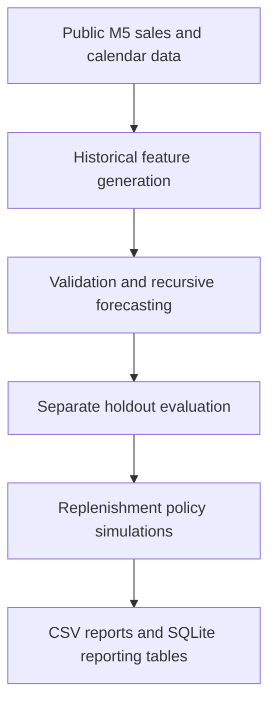

# StockWise - Demand Forecasting & Replenishment

A Python/SQL forecasting experiment connecting time-series model evaluation to inventory-policy simulation. Compare simple demand baselines with Poisson histogram boosting, then inspect how forecast choices affect availability and inventory under explicit assumptions.

**Stack:** Python, Pandas, NumPy, scikit-learn, SQLite, unittest.

## What it builds

1. Select 50 product-store series from the public M5 retail dataset using identifiers and early history only.
2. Construct lag, rolling, calendar and static features without using future sales.
3. Compare seasonal-naive, trailing-mean and Poisson histogram-gradient-boosting forecasts across three pre-test validation windows and one separate 28-day test.
4. Feed forecasts into daily replenishment simulations with 3- and 7-day lead times.
5. Export model errors, simulated inventory outcomes, source hashes, SQL tables and SKU exception reports.



## Reference results

Saved experiment: **16 October 2026**, 50 sampled product-store series. Final test covers **25 April-22 May 2016**.

| Method | Mean validation WAPE | Test WAPE | Test MAE |
|---|---:|---:|---:|
| Seasonal naive, 7-day | 0.8266 | 0.7748 | 1.5871 |
| Trailing mean, 28-day | **0.6721** | 0.6802 | 1.3934 |
| Poisson histogram boosting | 0.6854 | **0.6573** | **1.3466** |

Validation selected **trailing mean**. Boosting subsequently performed better on the separate test; test performance did not determine validation selection. WAPE is the sum of absolute errors divided by total actual sales across the evaluated sample.

See [RESULTS.md](RESULTS.md) for the saved inventory scenarios and [results/summary.json](results/summary.json) for machine-readable metrics.

## Run

Python 3.11 or newer:

```bash
python -m venv .venv
# Linux/macOS: source .venv/bin/activate
# Windows: .venv\Scripts\activate
python -m pip install -r requirements.txt
python -m unittest discover -p test_stockwise.py -v
python stockwise.py --archive data/m5.zip --out results
```

The experiment downloads the public M5 archive from the documented Nixtla mirror if it is absent. Raw data, the generated SQLite database and large per-day/per-forecast exports are not committed. A full run regenerates those outputs.

## Evaluation and engineering decisions

- **Temporal selection:** three 28-day validation windows precede the final 28-day holdout; models use the preceding 730 days.
- **Recursive forecasts:** predictions feed subsequent horizon features; actual future sales never enter the same forecast horizon.
- **Fixed parameters:** model hyperparameters were fixed before final evaluation.
- **Comparable policies:** each lead-time scenario shares initial inventory and a fixed historical-volatility safety buffer across methods.
- **Reproducible outputs:** manifests record the dataset SHA-256, sampled identifiers, features, dates and software versions.
- **Queryable reports:** SQLite unique keys and SQL views expose forecast errors, inventory summaries and SKU exceptions.

## Tests

The unit tests run without downloading M5:

- Recursive forecasts feed predictions back without modifying the original history.
- Changes in future demand cannot affect earlier replenishment orders.
- Receipts obey the full lead time and preserve stock/fulfilment conservation.

## Repository files

| Path | Purpose |
|---|---|
| `stockwise.py` | Data selection, features, model comparison, simulation and output export |
| `report_queries.sql` | SQLite tables, indexes and reporting views |
| `test_stockwise.py` | Temporal-isolation and inventory-flow tests |
| `results/` | Small archived reference metrics and manifests |
| `DATA_SOURCES.md` | Dataset attribution and methodological references |
| `RESULTS.md` | Detailed reference results and interpretation |

## Scope

The data is **US retail sales from M5**, not employer, Indian-market or pharmaceutical data. Observed sales proxy for demand; unobserved stockout demand is not recovered. Inventory lead times, holding/lost-sales costs and safety buffers are simulation assumptions. These results describe a sampled experiment, not the full M5 leaderboard, production deployment, financial savings or a calibrated service guarantee.

The source dataset remains subject to its original provider terms. The original data archive is not distributed here.
